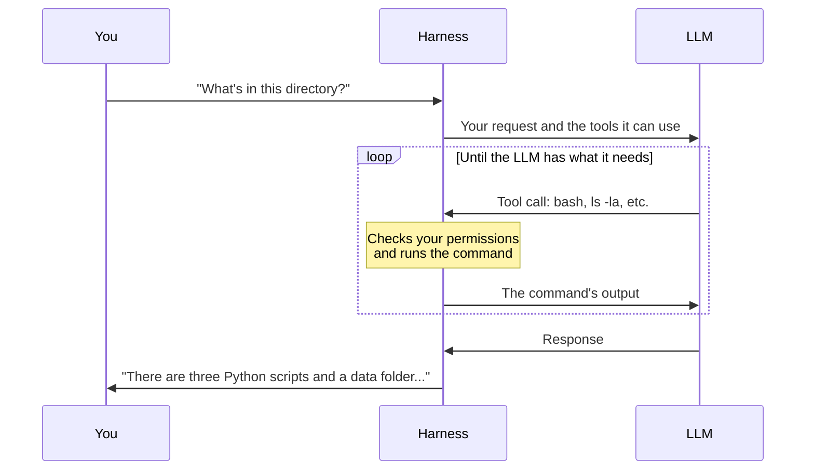

# OpenCode

OpenCode is a harness, the program side of a coding agent%. It runs in your terminal or a code editor like VS Code. You describe tasks in plain language, such as "write a Slurm% job script" or "fix this crash". It reads files, proposes changes, and runs commands if you allow it.

On LUMI, OpenCode runs in a ready-made container%. You can also install it on your computer.

## How an agent works

An agent has two parts: the LLM% to decide what to do, and the harness to execute it. We use "agent" to mean both together. The harness sends your request and a list of available tools (like reading files or running commands) to the LLM.

The LLM outputs text in a specific format to call tools. For example, Qwen3.6 models use this format to run a command:

```
<tool_call>
<function=bash>
<parameter=command>
ls -la
</parameter>
</function>
</tool_call>
```

The harness recognises the tool call, checks your permissions, runs the command, and sends the output back to the LLM. This is tool calling, and it requires an LLM trained to do it reliably.

Here is the process:



## Why OpenCode

OpenCode is similar to Claude Code or Codex, but it is open source% and independent. You can use it with almost any LLM provider, including Aitta. 

You do not have to use OpenCode. Aitta supports most harnesses that use OpenAI-compatible providers. However, Claude Code only works with Anthropic's API%, so it cannot use Aitta directly (though it can use the LUMI MCP% server).

## Before you start: what not to do

An agent runs commands under your user account, making **you** responsible for its actions. Read the [AI agent guide](https://docs.lumi-supercomputer.eu/development/ai-tools/ai-agent-guide/) before your first session. Key points:

> [!warning] Using agents on LUMI
> - **Stay in charge.** Monitor your agent and avoid running multiple at once.
> - **Save often.** Login nodes can become unstable, stopping agent processes without notice. Save frequently and avoid unsupervised sessions.
> - **Protect your work.** Agents can overwrite or delete files without asking. Keep backups or use version control.
> - **Keep it contained.** Run the harness in a container to limit access, and never use elevated privileges.
> - **Mind the shared system.** Disruptive processes that query Slurm endlessly or submit bad jobs affect everyone and may be stopped. Check job settings before submission.
> - **No sensitive data.** Never give an agent sensitive data. Use synthetic data instead.
> - **Guard your credentials.** Never give passwords or SSH keys to an agent on a third-party system.

Running a harness on a login node% is fine. Login nodes handle light tasks like code editing. Compute-heavy tasks belong on compute nodes% via Slurm.

## OpenCode on LUMI

On LUMI, OpenCode runs in a pre-configured container. Go to your working directory and start OpenCode:

```bash
module load Local-LAIF lumi-aif-agents
opencode
```

The container connects OpenCode to Aitta and the LUMI MCP server automatically. You just need to add your API token% and pick an LLM:

1. Type `/connect` and search for `aitta`.
2. Paste your API token from [Aitta](/01_aitta).
3. Select an LLM from the list or type `/models`.


OpenCode saves the token in your home directory. You only need to add it again (`/connect`) when it expires in 90 days.

Compared to a standard installation, the container:

- **Asks before acting.** It asks permission before using tools, except for the LUMI MCP server. You can allow actions once or for the session. Choose "Allow once" unless you are sure, as the agent can reach your API token folder.
- **Knows about LUMI.** The MCP server lets the agent search LUMI docs and check system status. The container also provides a short list of LUMI rules.
- **Only sees your directory.** The agent can only read the working directory% you start it in and its subfolders.
- **Cannot use Slurm.** Slurm is unavailable inside the container. The agent can write job scripts, but you must submit them yourself.


<details>
<summary>Optional: give the agent access to more directories</summary>

To give the agent access to other folders, add them to `SINGULARITY_BIND` before starting OpenCode. For example, to allow access to a `/scratch` directory:

```bash
cd /project/project_462000000/my-code
module load Local-LAIF lumi-aif-agents
export SINGULARITY_BIND=$SINGULARITY_BIND,/scratch/project_462000000/data
opencode
```

Keep `$SINGULARITY_BIND,` at the start, as the module uses it for LUMI software directories.

</details>

## OpenCode on your own machine

On macOS or Linux, install OpenCode using the install script:

```bash
curl -fsSL https://opencode.ai/install | bash
```

For Windows or Docker, check the [OpenCode installation guide](https://opencode.ai/docs/).

By default, OpenCode uses OpenCode Zen, sending data to its maintainers. To use Aitta and the LUMI MCP server instead, save this configuration as `~/.config/opencode/opencode.json`:

[opencode.json](./assets/opencode.json)

<details>
<summary>Show the contents of opencode.json</summary>

```json title="~/.config/opencode/opencode.json"
{
  "$schema": "https://opencode.ai/config.json",
  "model": "aitta/Qwen/Qwen3.8-27B",
  "permission": {
    "bash": "ask",
    "edit": "ask",
    "webfetch": "ask",
    "websearch": "ask"
  },
  "mcp": {
    "lumi-aif": {
      "type": "remote",
      "url": "https://lumi-aif-agents.2.rahtiapp.fi/mcp",
      "enabled": true
    }
  },
  "provider": {
    "aitta": {
      "npm": "@ai-sdk/openai-compatible",
      "name": "Aitta",
      "options": {
        "baseURL": "https://aitta-api.csc.fi/openai/v1"
      },
      "models": {
        "openai/gpt-oss-120b": { "name": "openai/gpt-oss-120b" },
        "Qwen/Qwen3-Coder-Next": { "name": "Qwen/Qwen3-Coder-Next" },
        "Qwen/Qwen3.8-27B": { "name": "Qwen/Qwen3.8-27B" },
        "Qwen/Qwen3.6-35B-A3B": { "name": "Qwen/Qwen3.6-35B-A3B" },
        "Qwen/Qwen3.6-27B": { "name": "Qwen/Qwen3.6-27B" },
        "Qwen/Qwen3-VL-30B-A3B-Thinking": { "name": "Qwen/Qwen3-VL-30B-A3B-Thinking" },
        "google/gemma-4-31b-it": { "name": "google/gemma-4-31b-it" },
        "google/gemma-4-26B-A4B-it": { "name": "google/gemma-4-26B-A4B-it" },
        "mistralai/Ministral-3-14B-Reasoning-2512": { "name": "mistralai/Ministral-3-14B-Reasoning-2512" },
        "meta-llama/Llama-3.3-70B-Instruct": { "name": "meta-llama/Llama-3.3-70B-Instruct" },
        "LumiOpen/Llama-Poro-2-70B-Instruct": { "name": "LumiOpen/Llama-Poro-2-70B-Instruct" },
        "swiss-ai/Apertus-70B-Instruct-2509": { "name": "swiss-ai/Apertus-70B-Instruct-2509" },
        "swiss-ai/Apertus-8B-Instruct-2509": { "name": "swiss-ai/Apertus-8B-Instruct-2509" }
      }
    }
  }
}
```

</details>

What the file does:

- **`model`** sets Qwen3.8-27B on Aitta as the default LLM.
- **`permission`** configures what the agent can do without asking.
- **`mcp`** connects the [LUMI MCP server](/03_mcp_server).
- **`provider`** points to Aitta and lists available models.
- **`models`** lists Aitta LLMs supporting tool calling (as of October 2026). Aitta's selection changes, so check available models if needed.

After saving it, run `opencode` in your project folder:

1. Type `/connect` and select `aitta`.
2. Paste your API token from [Aitta](/01_aitta).
3. Start prompting. Qwen3.8-27B is pre-selected; type `/models` to switch.

### What the agent can do without asking

With this configuration, the agent can read local files without asking. It asks permission before modifying files, running commands, or accessing the internet:

| Without asking | Asks first |
|:---------------|:-----------|
| Reading and searching files in the starting directory | Running commands |
| Checking the LUMI MCP server | Modifying or deleting files |
| Planning work and asking you questions | Fetching web pages |
| | Accessing files outside the starting directory |

Reading files is harmless, so asking each time slows you down. Commands and file edits can delete work, and web pages can contain hidden instructions (prompt injection). OpenCode also asks permission if the agent repeats an action three times.

Everything the agent reads goes to the LLM. With Aitta, data stays on LUMI. Keep passwords and API keys out of read access. OpenCode helps by blocking `.env` files.

### Keeping it contained

On your computer, a command run by the agent can reach any file your account can access. To limit the agent to a specific folder, run the harness in a container. Docker's guide to [bind mounts](https://docs.docker.com/engine/storage/bind-mounts/) explains how to isolate the project directory.

## Knowledge check

```quiz
title: Check your understanding

Q: You start OpenCode in the LUMI container for the first time. What do you still need to do before your first prompt?
- [x] Add your Aitta API token with `/connect`
- [x] Pick one of Aitta's LLMs
- [ ] Add Aitta as a provider
- [ ] Connect the LUMI MCP server
> The container already connects OpenCode to Aitta and the LUMI MCP server, so all that is left is your API token and an LLM.

---

Q: On your own machine, with the configuration on this page, which of these does the agent do without asking?
- [x] Reading a file in the directory you started it in
- [x] Searching the LUMI documentation through the MCP server
- [ ] Running a command
- [ ] Fetching a web page
> Reading files and searching the LUMI documentation cannot change anything. Commands, file changes and web access wait for your approval.

---

Q: Your agent has written a Slurm job script. What happens next?
- [ ] The agent submits it from inside the container
- [x] You check it against the LUMI documentation and submit it yourself
> Slurm is not available inside the container, and the AI agent guide asks you to check any job settings an agent suggests.
```
