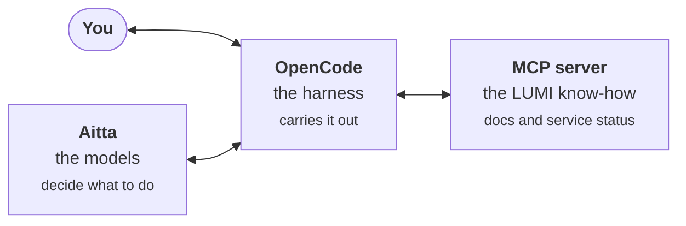

# LUMI Agent Ecosystem

An AI agent does everyday coding tasks for you, like writing a job script, finding a bug, or explaining an error. Instead of copying code back and forth from a chatbot, an agent works with your files and terminal directly.

An agent consists of two parts: an LLM% to decide what to do, and a program called the harness to carry it out by reading files, editing code, and running commands in your terminal or code editor. Some use "agent" to mean just the harness. On this site, the agent is the complete package (LLM plus harness), and the harness is just the program.

The harness is lightweight and runs on LUMI or your computer. A capable LLM needs powerful GPUs%, so it usually runs elsewhere, like Aitta. This site explains how these pieces connect and links to the relevant guides.

## The three pieces

They work well together, but you can also use them on their own. Below is a quick overview. The [Aitta](/01_aitta), [OpenCode](/02_opencode), and [MCP server](/03_mcp_server) chapters provide full details.

### Aitta: the models

Aitta is an inference platform%, similar to OpenAI or Anthropic, but it runs open-weight LLMs on LUMI's GPU nodes%. You chat with them in a browser or connect via an API%. Your prompts stay on LUMI's hardware. The API uses the OpenAI format, meaning most harnesses can connect to it.

### OpenCode: the harness

OpenCode is a harness running in your terminal or code editor, similar to Claude Code or Codex. It is open source% and not tied to any AI company. You can use it with almost any LLM provider, including Aitta. It runs as a container on LUMI, or you can install it on your computer.

### The MCP server: the LUMI know-how

An LLM only knows its training data, which rarely includes current LUMI details. The LUMI AI Factory MCP% server lets your agent search LUMI's documentation and check service status. This grounds its answers in current facts rather than guesses. It works with most harnesses, not just OpenCode.

## Where to start

- **New to this?** Read the chapters in order. Each starts with a simple explanation. Hover over an underlined term to see its [glossary](/glossary) definition.
- **Just want it running?** Get an API token from [Aitta](/01_aitta), then:
  - **On LUMI**, [start the OpenCode container](/02_opencode#opencode-on-lumi). It is already connected to Aitta and the MCP server. Just add your API token and select an LLM.
  - **On your own machine**, install OpenCode and download our [`opencode.json`](/02_opencode#opencode-on-your-own-machine) to connect Aitta and the MCP server.
  - **With another harness**, provide Aitta's base address and your API token (see [Getting started](/01_aitta#getting-started)), then connect the [MCP server](/03_mcp_server).